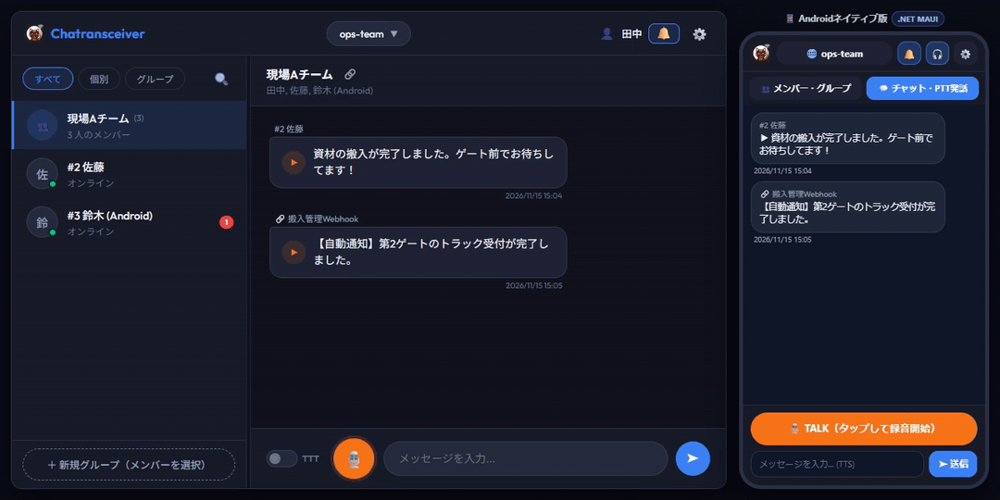
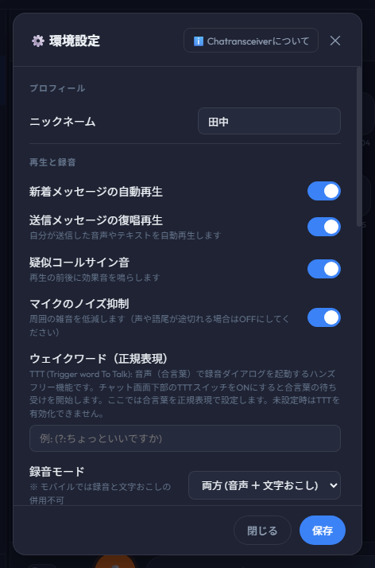
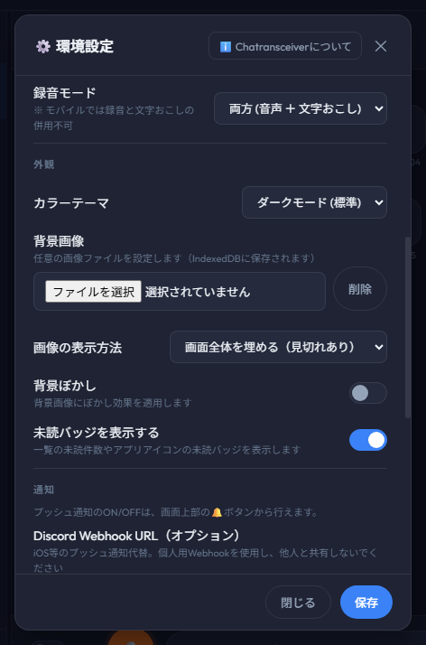
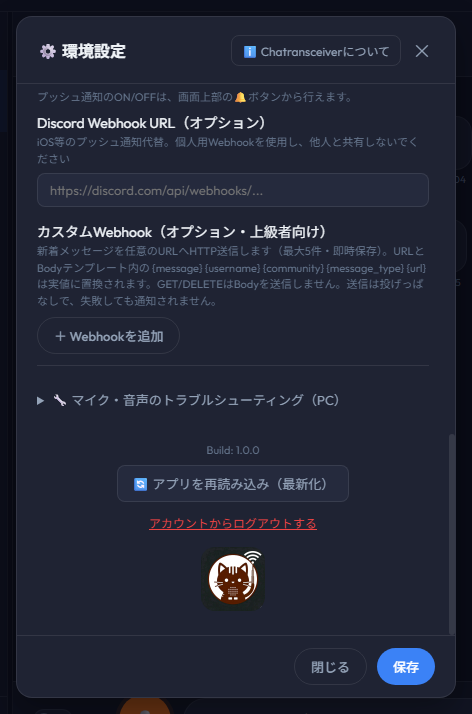

# Chatransceiver

> **15秒トランシーバー！文字起こし付き・半二重ボイスチャット（Web / PWA & Androidネイティブ対応）**



---

## 📖 概要 (What is this?)

Chatransceiver は、チャットUIの視認性とトランシーバーの即時性・操作性を融合した **半二重通信グループボイスチャットアプリ** です。  
Web / PWA 版（Chrome・iOS・Androidブラウザ）に加え、**Androidネイティブ版（.NET MAUI）** をモノレポで提供しており、同一の Supabase バックエンドおよび Firebase Cloud Messaging (FCM) を共有してリアルタイムに連携します。

* １メッセージあたり **最大15秒の音声PTT録音**
* 音声は **リアルタイム文字起こし**（PC Web Speech API）＆ **事後文字起こし**（スマホ・録音のみ向け Google Speech-to-Text）で自動テキスト化
* テキスト入力は受信側で **音声合成（TTS）による自動読み上げ**
* アプリを閉じていても **バックグラウンド通知・再生**（PC / Android）
* チャット履歴からいつでもリプレイ可能
* **Discord / カスタムWebhook / Incoming Webhook** による外部システム連携対応

---

## ✨ 主な機能 (Features)

### 🎙 音声・トランシーバー機能
* **音声PTT送信**: 最大15秒の音声録音。録音モードは「両方（音声＋文字おこし）」「録音のみ」「文字おこしのみ」から選択可能（スマホWebはデフォルト「音声のみ」）。
* **事後文字起こし (Google STT)**: スマホや「録音のみ」設定で送信された音声メッセージも、Edge Function (`transcribe-audio-message`) 経由で後から自動文字起こししてタイムラインに反映。
* **テキスト送信＆TTS読み上げ**: テキスト送信したメッセージも、受信側では音声合成（TTS）で自動読み上げ。
* **グローバル自動再生＆コールサイン音**: 表示中・未接続を問わず、着信メッセージを再生キューで順次自動再生。再生前後の疑似コールサイン音（ON/OFF可）と待機時間を最適化し、テンポよく聞き取れます。
* **送信メッセージの復唱再生**: 自分が送信したメッセージを手元で確認再生できる復唱機能を Web / Android 両方に搭載。
* **マイクのノイズ抑制 ON/OFF**: 周囲の雑音を低減するノイズ抑制スイッチを Web / Android 両方に搭載（声や語尾が途切れる環境では OFF に切替可能）。
* **TTT (Trigger word To Talk) ハンズフリー**: ウェイクワード（正規表現）を音声検知して自動で録音・送信するハンズフリーモード。
* **常時表示 (Screen Wake Lock)**: 画面の自動ロック・消灯を抑止し、受信待ち中もアプリを動かし続けます。

### 📱 Androidネイティブ版 (.NET MAUI) 特化機能
* **DeepSleep / バックグラウンド再生**: Android Foreground Service により、画面オフやスリープ状態でも着信音声を自動再生。
* **Bluetoothイヤフォン PTT＆自動音声モード切替**: 待機時は高音質な音楽再生モードを維持し、発話開始時に通話モードへ自動で切り替え。イヤフォン等の再生/停止ボタンでのPTT操作にも対応。
* **スピーカー・マイク切り替え**: 接続中の Bluetooth / 有線 / 本体の各デバイスに、音声出力（スピーカー）と入力（マイク）を個別に切り替え可能（初期値：システム規定に従う）。
* **バイブレーションフィードバック**: 発話開始・終了や操作時に端末のバイブレーションでフィードバック。
* **ネイティブUI調整**: チャットバブル下への年月日時刻（`yyyy/MM/dd HH:mm`）表示、ソフトな角丸UI、テーマに追従するヘッダースイッチ。

### 💬 チャット・通知・外部連携
* **グループチャット＆統合リスト**: メンバー／グループを1つの統合リストに表示し、フィルタチップ（すべて／個別／グループ）で絞り込み可能。グループ名はメンバーなら誰でも編集可能。
* **発言の取り消し**: 自分が送ったメッセージを取り消し（Storage の音声ファイル削除＋テキストクリア）。
* **バックグラウンド通知 & 未読バッジ**:
  * Webプッシュ通知（FCM）および Androidネイティブ FCM通知。
  * **PWA未読バッジ**: 対応環境で全コミュニティの未読合計をアプリアイコンに表示（Web / Android ともに環境設定で表示 ON/OFF 切替可能）。
* **Webhook 連携**:
  * **Discord Webhook**: 新着メッセージを Discord チャンネルへ自動通知。
  * **カスタムWebhook**: 任意の URL へ HTTP POST 送信（GAS 経由のメール転送などに対応）。
  * **Incoming Webhook**: 外部システムから Chatransceiver のトークルームへメッセージを投稿（`incoming-webhook` Edge Function）。
* **外観カスタマイズ & 認証**:
  * ダーク／ライトテーマ、カスタム背景画像（ぼかし対応、IndexedDB ローカル保存）。
  * Googleログイン、または Magic Link（メールリンク）認証。

---

## 🚀 使い方 (How to Use)

1. **ログインとコミュニティ参加**
   * アプリにアクセスし、「Google でログイン」または「Magic Link（メールリンク）」でログインします。
   * 招待リンクからアクセスするか、コミュニティ名ピルのメニューからコミュニティIDを入力して接続します。
2. **音声の送信 (PTT) / テキスト送信**
   * 画面下部のマイク（PTT）ボタンを押して話し始めます（最大15秒）。停止または送信クリックで音声と文字起こしが送信されます。
   * テキスト入力欄からの送信も可能です（受信側は TTS で自動読み上げ）。
3. **ハンズフリー / Bluetooth 操作（任意）**
   * **TTT**: 環境設定でウェイクワードを登録し、TTT スイッチを ON にすると合言葉の発話で録音が自動起動します。
   * **常時表示 (☀️)** / **メディアボタンPTT (🎧)**: ヘッダーのスイッチからワンタップで有効化できます。
4. **環境設定 (⚙️)**
   * ニックネーム、自動再生、送信メッセージの復唱再生、疑似コールサイン音、録音モード、マイクノイズ抑制、未読バッジ表示、スピーカー・マイクデバイス切替（Android）、各種 Webhook URL を設定できます。
5. **注意点**
   * グループやチャット履歴はメンバー間で削除可能です。半二重非同期通信による連絡のきっかけツールとしての利用を想定しており、機密情報や永続化が必要な情報の保存には向いていません。

---

## ⚙️ 環境設定項目 (Settings)

Web版の環境設定モーダル（モック画面）と各項目の説明です。

<p align="center">
  
  
  
</p>

| セクション | 項目名 | 説明 | 対象 |
| :--- | :--- | :--- | :--- |
| **プロフィール** | ニックネーム | タイムラインやメンバー一覧に表示される表示名 | Web / Android |
| **再生と録音** | 新着メッセージの自動再生 | 着信した音声・テキスト（TTS）メッセージを自動で順次再生する | Web / Android |
| | 送信メッセージの復唱再生 | 自分が送信した音声やテキストを手元で自動再生して確認する | Web / Android |
| | 疑似コールサイン音 | 再生の前後にトランシーバー風の効果音を鳴らす | Web / Android |
| | マイクのノイズ抑制 | 周囲の雑音を低減する（声や語尾が途切れる場合は OFF に切替） | Web / Android |
| | ウェイクワード（正規表現） | TTT（Trigger word To Talk）で録音を自動起動する合言葉を正規表現で指定 | Web |
| | 録音モード | `両方 (音声＋文字おこし)` / `録音のみ` / `文字おこしのみ` を選択（※モバイルWebは録音と文字おこしの併用不可） | Web / Android |
| **外観** | カラーテーマ | `ダークモード (標準)` / `ライトモード` を切り替え | Web / Android |
| | 背景画像 | 任意の画像をチャット背景に設定（ブラウザの IndexedDB にローカル保存） | Web |
| | 画像の表示方法 | 背景画像のフィット方法（`画面全体を埋める` / `画像全体を表示する`） | Web |
| | 背景ぼかし | 背景画像にぼかし効果を適用する | Web |
| | 未読バッジを表示する | 一覧の未読件数やアプリアイコンの未読バッジ表示の ON/OFF | Web / Android |
| **通知** | Discord Webhook URL | 新着メッセージを個人用 Discord Webhook へ転送（iOS 等の通知代替） | Web / Android |
| | カスタムWebhook | 新着メッセージを任意の URL へ HTTP 送信（最大5件・プレースホルダー置換対応） | Web |
| **その他** | マイク・音声のトラブルシューティング | Chrome のマイク許可・音声自動再生設定画面の URL コピー（PC 向け） | Web |
| | アプリを再読み込み（最新化） | キャッシュを更新して最新ビルドを再読み込みする | Web |
| | アカウントからログアウトする | 現在のアカウントからサインアウトする | Web / Android |
| **Android専用** | スピーカー・マイク切り替え | 接続中の Bluetooth / 有線 / 本体デバイスに出力・入力を個別に固定 | Android |
| | 着信・通知時のバイブレーション | メッセージ着信やプッシュ通知時に端末を振動させる | Android |
| | バッテリー制限解除を許可 | DeepSleep 中の自動再生を維持するためバッテリー最適化の除外を要求 | Android |

---

## 🛠 技術スタック (Tech Stack)

* **Frontend (Web / PWA)**: HTML / Vanilla CSS / TypeScript (Vite 8) / PWA (Service Worker, Web App Manifest)
* **Mobile (Android Native)**: C# / .NET 9 / .NET MAUI (`net9.0-android`, Android 8.0 / API 26 以上, `android/Chatransceiver.Maui`)
* **Backend**: Supabase (Auth, PostgreSQL, Storage, Realtime, Edge Functions)
* **Web標準API**: Web Speech API / Screen Wake Lock API / Media Session API / IndexedDB
* **通知・音声認識**: Firebase Cloud Messaging (FCM) / Google Speech-to-Text API / Discord & Custom & Incoming Webhooks
* **Hosting / CI**: Firebase Hosting / GitHub Actions (`firebase-hosting-merge.yml`, `android-build.yml`)

---

## 💻 開発者向け：ローカル環境の構築手順 (Getting Started)

### 前提条件
* Node.js (v20 以上推奨)
* npm
* Supabase CLI (Edge Functions のローカルテスト・デプロイ用)
* .NET 9 SDK + MAUI Android ワークロード (Androidネイティブ版をビルドする場合)

### Web / PWA セットアップ
1. リポジトリのクローン
   ```bash
   git clone <repository-url>
   cd Chatransceiver
   ```
2. 依存関係のインストール
   ```bash
   npm install
   ```
3. 環境変数の設定
   * リポジトリ直下に `.env` ファイルを作成し、Supabase の接続情報を記載します（`.env.example` を参照）。
4. ローカル開発サーバーの起動
   ```bash
   npm run dev
   ```

### ビルドと検証
* `npm run test:badge`: 未読バッジの更新・解除・非対応環境・失敗分離を外部接続なしで自動検証します。
* `npm run build`: TypeScript 型チェックと本番ビルドを実行します。
* `npm run build:android` / `npm run publish:android`: Androidネイティブ版 (.NET MAUI) を Release ビルドします。
  * ルートの `.env` がある場合、MSBuild ターゲットが `Services/AppConfig.Defaults.cs` を自動生成して `VITE_SUPABASE_URL` / `VITE_SUPABASE_ANON_KEY` を注入します。
  * FCM を有効にする場合は、`android/Chatransceiver.Maui/google-services.json` を配置してください。

### デプロイ
* **フロントエンド**: `npm run deploy` (Firebase Hosting)
* **バックエンド (Supabase Edge Functions)**: 以下の5つの関数をデプロイします。
  ```bash
  supabase functions deploy send-push-notification         # 新着メッセージのFCM/Discord/カスタムWebhook通知
  supabase functions deploy register-fcm-token             # FCMデバイストークン登録
  supabase functions deploy delete-audio-on-message-delete # メッセージ削除時の音声ファイル削除
  supabase functions deploy transcribe-audio-message       # Google Speech-to-Text 事後文字起こし
  supabase functions deploy incoming-webhook               # 外部システムからのIncoming Webhook受信
  ```

---

## 📚 プロジェクトドキュメント (Documentation)

開発に関わる設計や仕様については、`docs/` ディレクトリを参照してください。
* [コンテキスト・プロジェクト概要 (context.md)](./docs/context.md)
* [機能仕様書 (specifications.md)](./docs/specifications.md)
* [データベース設計 (database_design.md)](./docs/database_design.md)
* [意思決定ログ (decisions.md)](./docs/decisions.md)
* [議論・未解決事項 (discussion.md)](./docs/discussion.md)
* [Androidネイティブ版 (.NET MAUI) 実装ブループリント (android_implementation_plan.md)](./docs/android_implementation_plan.md)
* [バックエンド構築手順 (setup_backend.md)](./docs/setup_backend.md) / [フロントエンド構築手順 (setup_frontend.md)](./docs/setup_frontend.md)
* [事後文字起こし仕様 (stt_transcription_spec.md)](./docs/stt_transcription_spec.md)
* [Incoming Webhook 仕様 (incoming_webhook_spec.md)](./docs/incoming_webhook_spec.md) / [カスタムWebhook 仕様 (custom_webhook_spec.md)](./docs/custom_webhook_spec.md)
* [ボット機能仕様ドラフト (bot_function_spec.md)](./docs/bot_function_spec.md)

---

## ⚖️ ライセンス・免責事項 (License & Disclaimer)

* 本プロジェクトは [MIT License](./LICENSE) のもとで公開されているオープンソースソフトウェアです。ライセンスの条件に従い、実装・運用・改変・再配布を自由に行えます。
* 本ソフトウェアは現状有姿（AS IS）で提供されており、動作保証やサポート義務はありません。**本アプリを使用したこと、または使用できなかったことによって生じたいかなる損害（通信遅延・通知不達・データ消失などを含む）についても、作者は一切の責任を負いません。**自己責任にてご利用ください。

---

## 🤖 AI Assistant Guidelines (AIへの指示)

このプロジェクトでは、AIアシスタントと共同で仕様を議論しながら開発を進めています。  
**セッションがリセットされた際や、新しく開発に参加したAIは、まず以下の手順でコンテキストを復元してください。**

### 1. 復元手順
1. `docs/context.md` を読み込み、プロジェクトの目的と全体像を把握する。
2. `docs/discussion.md` を読み込み、現在議論中のトピックや次に話すべきアジェンダを確認する。
3. `docs/specifications.md` と `docs/decisions.md` を読み込み、これまでに確定した仕様と決定経緯を把握する。
4. 復元が完了したら、ユーザーに「ここまでの文脈を理解しました。現在議論中の〇〇について話を進めましょう」と提案する。

### 2. ドキュメント運用のルール
議論が進む中で、仕様や状況に変化があった場合は、AIが責任を持って以下のファイルを更新してください。
* `docs/context.md`: 全体像や技術スタックの更新
* `docs/specifications.md`: 確定した仕様の追記・整理
* `docs/decisions.md`: 決定した事項とその理由のログ追加
* `docs/discussion.md`: 議論中・未解決事項のアップデート
